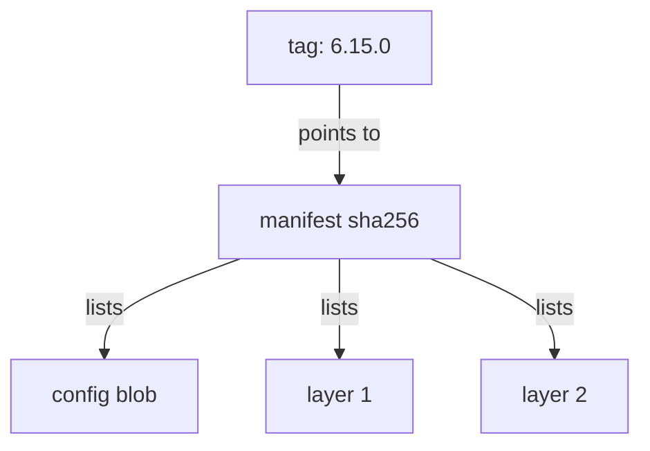

# Image References And Stored Layers

Every pod specification names its images as strings, and a node turns each string into a series of HTTP requests to a registry. A reader who understands that translation can say exactly what a registry stores, what can change underneath a name, and what an attacker gains from read or write access. This part takes one reference apart and then reads the same content straight from the registry.

## Anatomy of an image reference

Take the reference `localhost:30500/starfleet/podinfo:6.15.0`. It has four parts. The registry host and port, `localhost:30500`, say which server to call. The repository path, `starfleet/podinfo`, says which collection of images on that server. The tag, `6.15.0`, is a label inside the repository. A fourth part can follow the tag: a digest, written `@sha256:` and 64 hexadecimal characters.

If the host is missing, the container runtime assumes Docker Hub. If the tag is missing, it assumes `latest`. These defaults matter for security: `podinfo` with no host pulls from a public registry that the cluster owner does not control, so a typing mistake changes the trust decision.

A tag is mutable. The registry stores it as a pointer from a name to a digest, and anyone with push rights can point the name at a different digest. The digest is the hash of the image manifest, so it changes when anything in the image changes. A reference with a digest cannot silently change content.

## What a registry stores

A registry stores three kinds of objects, and all of them are addressed by digest. A **manifest** is a small JSON document that lists the pieces of one image. A **configuration blob** holds the image settings, such as the default command and the environment variables. A **layer** is a compressed archive of file system changes. The manifest lists the digest of the configuration and the digest of each layer, in order.

A node pulls an image in this order. It requests the manifest by tag or digest. It reads the list of layers. It requests each layer it does not already have, by digest, and verifies the hash of what it receives. Layers are shared between images, so two images with the same base layer store it once.



The diagram shows that the tag only points to a manifest, and the manifest lists the digests of the configuration and every layer.

## Read the registry through its API

The registry in the playground speaks the OCI distribution API, the same protocol that every node uses. The `shuttle` pod has `curl`, so it can call the registry. Credentials are required, and you use the `publisher` account for this part.

<!-- astrona:playground:renew -->

List the repositories in the registry:

```sh
kubectl -n starfleet exec deploy/shuttle -- curl -s -u publisher:push-pass-3 http://registry.registry.svc.cluster.local:5000/v2/_catalog
```

The answer is a JSON object with a list of repository names. It should contain `starfleet/podinfo`. Now list the tags in that repository:

```sh
kubectl -n starfleet exec deploy/shuttle -- curl -s -u publisher:push-pass-3 http://registry.registry.svc.cluster.local:5000/v2/starfleet/podinfo/tags/list
```

The answer names the repository and lists its tags. Next ask for the manifest of the tag, and print the response headers with `-i` so that the digest is visible. The `Accept` header tells the registry which manifest formats the client understands:

```sh
kubectl -n starfleet exec deploy/shuttle -- curl -s -i -u publisher:push-pass-3 -H 'Accept: application/vnd.oci.image.manifest.v1+json, application/vnd.docker.distribution.manifest.v2+json' http://registry.registry.svc.cluster.local:5000/v2/starfleet/podinfo/manifests/6.15.0
```

The response headers include `Docker-Content-Digest`, the digest of the manifest. The body is the manifest, with the digest and size of the configuration and of each layer. That header value is the identity a pinned reference would use.

The same API can fetch any layer by its digest. A person who can pull the image can therefore download every layer and unpack it on their own machine. For this reason a secret copied into any layer must be treated as published to everyone who has pull access.

## What read and write access mean

Read access to a repository means the ability to fetch manifests and layers. The attacker or curious insider gets the full file system of every image: binaries, configuration files, embedded keys and the history of build steps in the configuration blob. Read access also lets someone scan the image for vulnerabilities and plan an attack on workloads that run it.

Write access means the ability to push blobs and move tags. The attacker can push a new image and point the tag that production uses at it. Every node that later pulls that tag runs the attacker's code. Pinning by digest defends the pull side, because the digest of the attacker's image is different. Write access control defends the source.

The two kinds of access need different people. Many people and systems must read, because every node pulls. Few must write, and only the build system should. Treat these as separate credentials from the start.

You now know what a registry holds and how names map to content. What is still open is how a registry decides who may call those endpoints.

## A worked example of a moved tag

Imagine the build system pushes `starfleet/podinfo:6.15.0` on Monday, and the digest ends in `...a1`. A Deployment uses the tag. On Tuesday someone with push rights uploads a modified image under the same tag, and the digest now ends in `...b2`. Pods that already run keep the old content. Any pod that starts afterwards, for example after a node restart or a scale-up, can pull `...b2` if its node has no cached copy.

The cluster then runs two versions of one Deployment, and nothing in the Kubernetes objects shows it. The pod specification still says `6.15.0`. Only the `imageID` in the pod status differs. A reference by digest removes the problem, and a registry setting that makes tags immutable (offered by many hosted registries) removes it at the source.

## Layers on the node

A node stores pulled layers in its container runtime store, not in Kubernetes. The next pod that uses the same layers reuses them without contacting the registry for those blobs. This saves bandwidth, and it also means that content on a node can outlive the registry copy. If an image is deleted from the registry, nodes that cached it can still start it.

An image index (also called a manifest list) is a manifest that points to one manifest per platform, for example `linux/amd64` and `linux/arm64`. A tag can point at an index, and the node selects the entry that matches its platform. The digest of the index and the digest of the platform manifest are different values. When you pin a reference, check which of the two you recorded.

## Common pitfalls

> [!WARNING]
> - Writing an image name without a registry host and assuming it comes from your own registry. It comes from Docker Hub.
> - Treating a tag as a version number that never changes. Only the digest is fixed.
> - Putting a secret in a layer and deleting it in a later step. The earlier layer is still downloadable.
> - Giving every node or pipeline the same credential for push and pull.
