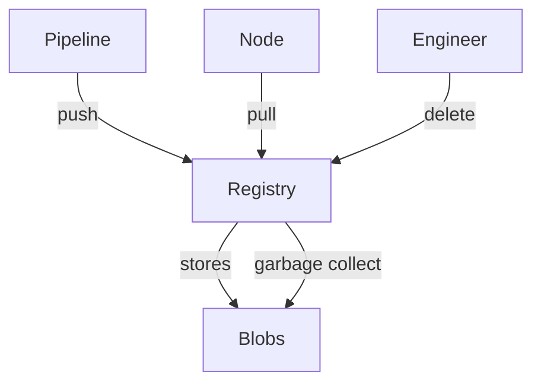

# Protecting Publishers, Readers And Repository State

A registry is a server with state: images, tags and the credentials that change them. Protecting it means answering four questions. Who proves their identity? What may each identity do? Which state may be deleted or overwritten? How long is old content kept? This part answers each question for the private registry in the playground and for registries in general.

## Authentication and authorization at a registry

The registry in the playground uses HTTP basic authentication with a password file. Authentication proves who is calling. Authorization decides what that caller may do. The open source `registry` image has authentication but only coarse authorization: every valid user can push and pull. Hosted registries and enterprise registries add authorization: a user, group or robot account receives separate permissions per repository, for example pull, push or delete.

First see what the registry says to a caller without credentials. Run the request from the `shuttle` pod and print the response headers:

<!-- astrona:playground:renew -->

```sh
kubectl -n starfleet exec deploy/shuttle -- curl -s -i http://registry.registry.svc.cluster.local:5000/v2/
```

The status line is `401 Unauthorized`. A `Www-Authenticate` header names the authentication scheme and the realm. This is the answer a container runtime also receives when it pulls a private image without credentials. Now repeat the call with the `puller` account:

```sh
kubectl -n starfleet exec deploy/shuttle -- curl -s -i -u puller:pull-pass-7 http://registry.registry.svc.cluster.local:5000/v2/
```

The status line is `200 OK`. The difference between the two calls is the only thing that Kubernetes pull Secrets provide: they let the node send the `Authorization` header.

## Push, pull and delete are different rights

A registry exposes three kinds of rights. Pull reads manifests and layers. Push writes layers and manifests and moves tags. Delete removes manifests or tags. A role-based registry lets you grant them separately, and a good design follows the work each identity does.

| Identity | Needs | Reason |
| --- | --- | --- |
| Build pipeline | Push to its own repositories | It publishes new images |
| Cluster nodes and pods | Pull from the repositories they run | They only read |
| Release engineers | Delete, in a controlled process | They clean up old images |
| Developers | Pull, sometimes push to a test project | They need to test, not to publish production images |

In the playground, `publisher` and `puller` both authenticate, but this registry does not separate their rights. That is a limit of the software, and the lesson is to choose a registry that supports separate rights and use pull-only credentials for the cluster. A pull credential that can also push turns a stolen node credential into a way to replace the image.

## Retention and deletion

A registry keeps content until someone removes it. Three kinds of state grow: old tags, untagged manifests that remain after a tag moved, and blobs that no manifest references. Retention rules decide what to keep. A good rule keeps every digest that production ever ran for as long as an investigation might need, and removes old test images.

Deleting an image is two steps in the open source registry. The API removes a manifest by digest only when the registry sets `REGISTRY_STORAGE_DELETE_ENABLED=true`. The blobs stay on disk until the garbage collector runs. Until then, the layers of a deleted image are still stored and a person with the right digests can still fetch them.

Security teams also need the opposite: a way to prevent deletion or overwrite. Tag immutability, supported by many hosted registries, rejects a push that would move an existing tag. Repository retention locks and backups protect the evidence needed after an incident.



The diagram shows three different actors using three different rights against one registry, and the blobs that remain until garbage collection.

## Transport and exposure

Credentials are only as safe as the connection that carries them. Registry traffic should use TLS, so a network attacker cannot read the `Authorization` header or replace a layer. The playground uses plain HTTP, and it can do so only because the node connects to `localhost`, which container runtimes accept without TLS. A registry reachable across a network needs a certificate that the nodes trust.

A registry should also not be open to the internet without need. Place it on a private network, restrict which networks can reach it, and keep the administrator interface off the public path.

## Watch a pod fail to pull

The `scout` Deployment uses `localhost:30500/starfleet/podinfo:6.15.0` and has no pull Secret. List its pod:

```sh
kubectl -n starfleet get pods -l app=scout
```

The pod does not become ready. Its status shows `ErrImagePull` and then `ImagePullBackOff`. Read the events to find the reason:

```sh
kubectl -n starfleet describe pod -l app=scout
```

The `Events` section contains a `Failed` event from the kubelet. Its message reports that the pull failed because the registry refused the request as unauthorized. The kubelet does not give up: it retries with a growing delay, and that delay is the `BackOff` in the status.

The pod specification is correct and the registry is healthy. The only missing piece is the credential, which is the next piece to add.

## Common pitfalls

> [!WARNING]
> - Using one registry account for the build pipeline and for every node.
> - Assuming that deleting a tag removes the layers. They remain until garbage collection.
> - Sending registry credentials over plain HTTP across a real network.
> - Leaving a registry open to anyone who can reach the cluster network.
