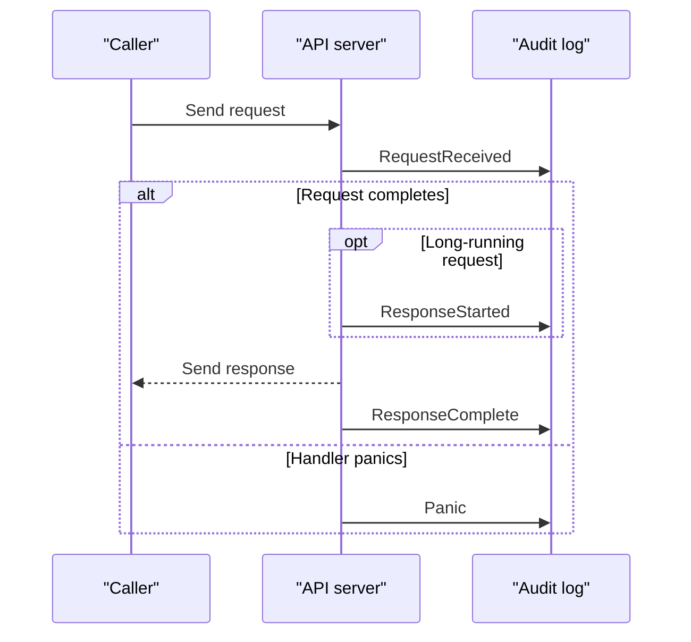
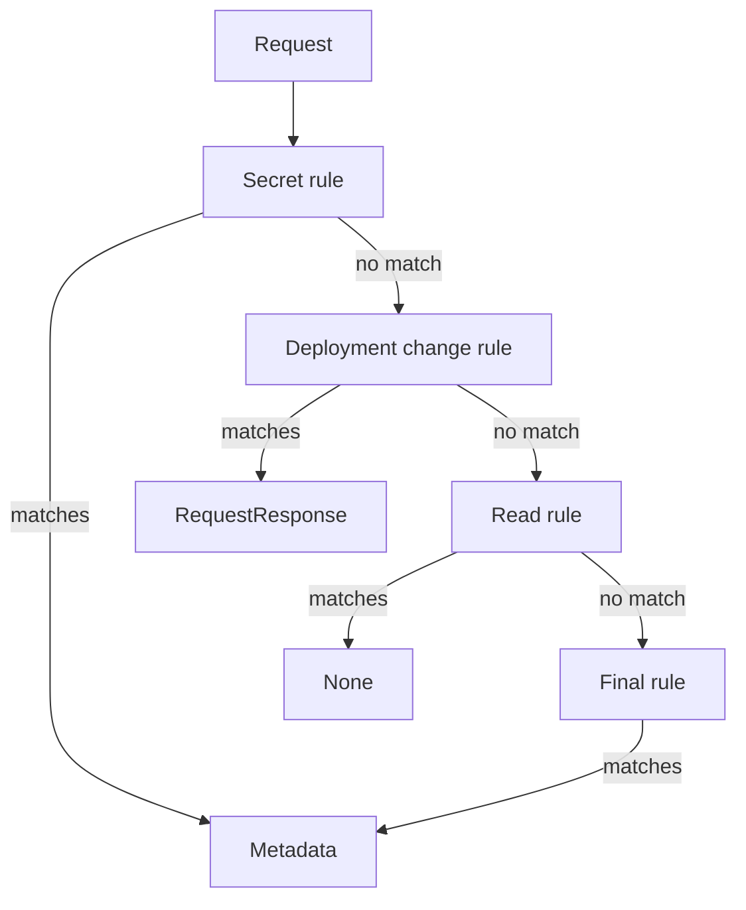

# Audit Policy Rules, Levels And Stages

The `deck-cleaner` CronJob in the playground reads a Secret and deletes a Deployment with the same identity. These two requests need different evidence. For the Secret, the name and the caller are useful, but the password must stay out of any log. For the Deployment change, a reviewer wants to see what the caller sent. The component that decides this is the audit policy of the Kubernetes application programming interface (API) server.

An **audit policy** is a file that tells the API server how much of each request to record. Audit logging only records activity. It does not grant access, and it does not reject a request. Authentication and authorization still decide who may act, and audit records what happened.

## Look at the starting state

The playground runs a CronJob, a resource that starts Jobs on a schedule. Its Job runs as the `deck-cleaner` service account, which is the identity its pod uses for API requests. Check the schedule and the identity first.

<!-- astrona:playground:renew -->

```sh
kubectl -n outpost get cronjob deck-cleaner -o jsonpath='{.spec.schedule}{"\n"}{.spec.jobTemplate.spec.template.spec.serviceAccountName}{"\n"}'
```

You should see something like:

```text
*/2 * * * *
deck-cleaner
```

The job runs every two minutes. Its calls appear in events as `system:serviceaccount:outpost:deck-cleaner`, because the service account lives in `outpost` even though it changes objects in `starfleet`.

Set a variable for the control plane node container and look for audit flags in the API server manifest:

```sh
export CONTROL_PLANE=astro-ats-045-playground-030-01-control-plane
podman exec "$CONTROL_PLANE" sh -c 'grep -- --audit /etc/kubernetes/manifests/kube-apiserver.yaml || echo "No audit flags configured"'
```

You should see:

```text
No audit flags configured
```

Docker users replace `podman` with `docker`. With no audit flags, the API server keeps no history of requests. A request that finished before audit logging was enabled cannot be recovered later.

## Levels and stages

An **audit event** is a record of one request at one point in its processing. Two fields describe the event. The **level** says how much detail the policy allowed. The **stage** says when in the request the API server produced the event.

| Level | What the event contains |
| --- | --- |
| `None` | No event |
| `Metadata` | Caller, verb, target, timestamps and response status, with no request or response body |
| `Request` | Metadata and the request body |
| `RequestResponse` | Metadata, the request body and the response body |

More detail is not automatically better. A response for a Secret contains the Secret data. A Deployment body can contain environment values that are sensitive. A log with full bodies for everything becomes a second store of confidential data, and everyone who can read the log can read it. Record Secrets at `Metadata` and limit who can read the log file.

The stage describes how far the request had progressed:

- `RequestReceived`: the API server received the request and has not handled it yet.
- `ResponseStarted`: the response headers were sent for a long-running request such as a watch.
- `ResponseComplete`: the response body finished.
- `Panic`: handling the request failed with a panic.



The diagram shows the possible stage events. A short request has no `ResponseStarted` event, and a panic is a separate failure path.

All stage events of one request share an `auditID`. This is how you group them without counting one request several times. The `RequestReceived` event has no response status yet, so the `ResponseComplete` event is the one that tells you the outcome. Most policies omit `RequestReceived` to halve the volume.

## What an event contains

A `Metadata` event for a Secret read has these fields among others:

- `user.username` and `user.groups`: the authenticated caller.
- `verb`: `get`, `list`, `watch`, `create`, `update`, `patch` or `delete`.
- `objectRef`: the resource, namespace, name and API group of the target.
- `requestURI`: the path that the caller used.
- `responseStatus.code`: the HTTP status such as 200 or 403.
- `sourceIPs`: the addresses the request came from.
- `stageTimestamp`: when the stage event was written.
- `annotations`: the authorization decision and its reason.

The user field is the identity that authentication produced. If two people use one shared credential, the event shows the credential and not the person. An event proves that a credential made a request. It does not prove which person held the credential.

## Rules are evaluated in order

The API server uses the first rule that matches a request. It never combines rules, and it never picks the most detailed level. Fields inside one rule narrow the match together. A list inside a field means any of its values. A missing field does not limit the match. A request that matches no rule is not recorded, which is the same as level `None`.

Save this as `audit-policy.yaml`:

```yaml
apiVersion: audit.k8s.io/v1
kind: Policy
omitStages:
  - RequestReceived
rules:
  - level: Metadata
    resources:
      - group: ""
        resources: ["secrets"]
  - level: RequestResponse
    verbs: ["create", "update", "patch", "delete"]
    resources:
      - group: apps
        resources: ["deployments", "deployments/scale"]
  - level: None
    verbs: ["get", "list", "watch"]
  - level: None
    nonResourceURLs: ["/healthz*", "/livez*", "/readyz*"]
  - level: Metadata
```

The first rule records every Secret request at `Metadata`, reads included. The empty `group` selects the core API group. The second rule records changes to Deployments in the `apps` group at `RequestResponse`. The name `deployments/scale` selects a subresource, which is a separate API path under the object. The third rule drops all other reads. It sits after the Secret rule, so it cannot hide Secret reads. The fourth rule drops health check paths for verbs that the third rule did not match. The last rule records everything else at `Metadata`.



The diagram shows that evaluation stops at the first match. Swapping the first and third rules would make Secret reads disappear from the log.

## Put the file where the API server can read it

The policy is not an API resource. Do not run `kubectl apply` on it. The API server reads the file from its own filesystem when it starts. Create the directories on the node and keep a backup of the manifest outside the watched directory:

```sh
podman exec "$CONTROL_PLANE" mkdir -p /etc/kubernetes/audit /var/log/kubernetes/audit
podman exec "$CONTROL_PLANE" cp /etc/kubernetes/manifests/kube-apiserver.yaml /etc/kubernetes/kube-apiserver.before-audit.yaml
podman cp audit-policy.yaml "$CONTROL_PLANE":/etc/kubernetes/audit/audit-policy.yaml
podman exec "$CONTROL_PLANE" cat /etc/kubernetes/audit/audit-policy.yaml
```

The last command prints the file back, which proves the copy. Nothing records events yet, because the API server does not know about the file. The API server reads the file only when it starts with the audit flags that point to it.

## Why the order and the level matter for evidence

A policy is a decision about future evidence. Three failures follow from a careless policy. A rule that is too broad at a high level writes secrets into the log. A rule that is too narrow leaves a gap that you only find during an incident. A rule order mistake gives the right level to the wrong requests. After enabling a policy, test it with real requests of each kind and read the events.

A useful starting policy has four parts: drop health checks and noisy reads, record sensitive resources at `Metadata`, record changes to security-relevant resources with bodies, and end with a catch-all at `Metadata`. Security-relevant resources include roles, role bindings and workload controllers. A catch-all at `Metadata` is cheap and answers who did what, even for resources that the policy did not name.

## Common pitfalls

> [!WARNING]
> The first matching rule wins, so a broad rule early in the file hides the rules below it. Never record Secrets above `Metadata`, because the log then holds the Secret data. A policy that is saved on the node but not passed to the API server records nothing.
