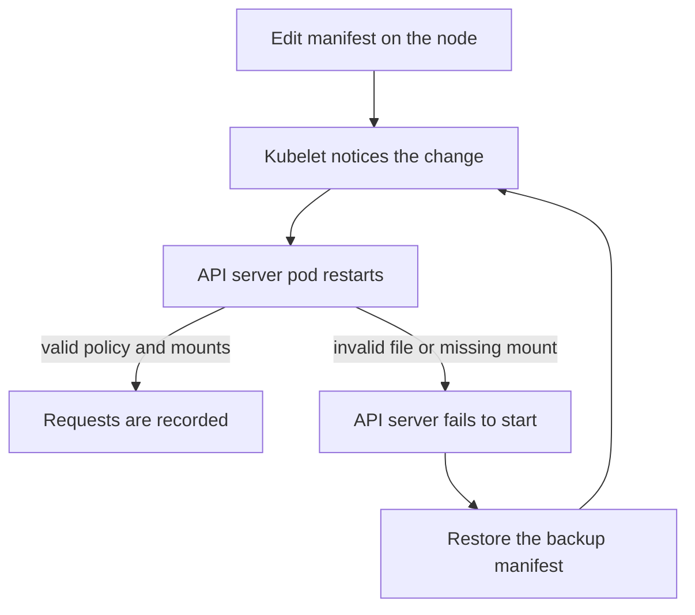

# Enable Audit Logging And Read Events

An audit policy file has no effect until the API server runs with the flags that point to it. In a kind cluster, as in clusters built by kubeadm, the API server is a static pod. A static pod is a pod that the kubelet starts from a manifest file in a directory on the node, not from an object in the cluster database. This part edits that manifest, waits for the restart and reads the first events.

## The flags

These flags control audit logging with a log file as destination:

| Flag | Meaning |
| --- | --- |
| `--audit-policy-file` | Path of the policy file, as seen from inside the API server container |
| `--audit-log-path` | Path of the log file inside the container. A dash writes to standard output |
| `--audit-log-maxage` | Days to keep rotated files |
| `--audit-log-maxbackup` | Number of rotated files to keep |
| `--audit-log-maxsize` | Size in megabytes at which the log rotates |

Without `--audit-log-maxbackup` and `--audit-log-maxage`, rotated files are not deleted. Without `--audit-log-maxsize`, the log never rotates. Both defaults can fill a node disk or keep data for longer than intended.

The API server runs in a container. A path in a flag is a path inside that container. For the policy file to exist there, and for the log to survive a restart, the manifest needs two host path volumes: one mounted read-only for the policy directory and one writable for the log directory.

## Edit the manifest

<!-- astrona:playground:renew -->

This part uses the policy file `audit-policy.yaml` on the control plane node. Check that the file is on the node and that the cluster answers:

```sh
export CONTROL_PLANE=astro-ats-045-playground-030-01-control-plane
podman exec "$CONTROL_PLANE" ls /etc/kubernetes/audit
kubectl get --raw=/readyz
```

You should see `audit-policy.yaml` and then `ok`. If the policy file is missing, create it on the node again. This command writes the same policy that the rules explain:

```sh
podman exec -i "$CONTROL_PLANE" sh -c 'mkdir -p /etc/kubernetes/audit /var/log/kubernetes/audit && cat > /etc/kubernetes/audit/audit-policy.yaml' <<'EOF'
apiVersion: audit.k8s.io/v1
kind: Policy
omitStages:
  - RequestReceived
rules:
  - level: Metadata
    resources:
      - group: ""
        resources: ["secrets"]
  - level: RequestResponse
    verbs: ["create", "update", "patch", "delete"]
    resources:
      - group: apps
        resources: ["deployments", "deployments/scale"]
  - level: None
    verbs: ["get", "list", "watch"]
  - level: None
    nonResourceURLs: ["/healthz*", "/livez*", "/readyz*"]
  - level: Metadata
EOF
podman exec "$CONTROL_PLANE" cp -n /etc/kubernetes/manifests/kube-apiserver.yaml /etc/kubernetes/kube-apiserver.before-audit.yaml
```

Copy the manifest to your machine:

```sh
podman cp "$CONTROL_PLANE":/etc/kubernetes/manifests/kube-apiserver.yaml kube-apiserver.yaml
```

Open `kube-apiserver.yaml`. Add these lines to the `command` list, directly after `- kube-apiserver`:

```yaml
    - --audit-policy-file=/etc/kubernetes/audit/audit-policy.yaml
    - --audit-log-path=/var/log/kubernetes/audit/audit.log
    - --audit-log-maxage=7
    - --audit-log-maxbackup=3
    - --audit-log-maxsize=10
```

Add these entries to `volumeMounts`:

```yaml
    - mountPath: /etc/kubernetes/audit
      name: audit-policy
      readOnly: true
    - mountPath: /var/log/kubernetes/audit
      name: audit-log
```

Add these entries to `volumes`:

```yaml
  - hostPath:
      path: /etc/kubernetes/audit
      type: Directory
    name: audit-policy
  - hostPath:
      path: /var/log/kubernetes/audit
      type: DirectoryOrCreate
    name: audit-log
```

Indentation matters. List items in `command` and `volumeMounts` use the same indentation as the entries already there. A tab or a wrong indent makes the file invalid, and the kubelet cannot start the pod.

Copy the file back. Writing it into the manifest directory is the change that the kubelet watches:

```sh
podman cp kube-apiserver.yaml "$CONTROL_PLANE":/tmp/kube-apiserver.yaml
podman exec "$CONTROL_PLANE" cp /tmp/kube-apiserver.yaml /etc/kubernetes/manifests/kube-apiserver.yaml
```

The kubelet notices that the manifest changed and recreates the API server pod. While that happens `kubectl` fails with a connection error. This is expected for up to a minute.

## Wait for the restart

Run the readiness request in a loop until it answers:

```sh
until kubectl --request-timeout=5s get --raw=/readyz >/dev/null 2>&1; do sleep 3; done; echo ready
```

Then confirm that the new pod carries the flag:

```sh
kubectl -n kube-system get pod "kube-apiserver-$CONTROL_PLANE" -o jsonpath='{.spec.containers[0].command}' | tr ',' '\n' | grep audit
```

You should see the five audit flags. If `kubectl` still fails after several minutes, read the kubelet's view of the pod through the container runtime on the node and look for a message about the file or the flag:

```sh
podman exec "$CONTROL_PLANE" crictl ps -a --name kube-apiserver
```

The most common causes are an indent error, a missing volume for a path in a flag, and a policy file that is not valid. Restore the backup by copying `/etc/kubernetes/kube-apiserver.before-audit.yaml` over the manifest, wait for the restart and try again. A policy file with an invalid rule stops the API server from starting, so test the YAML on your machine before copying it.



The diagram shows why a backup outside the manifest directory is the recovery path. While the API server is down, `kubectl` cannot fix it.

## Read events

The log is a file with one JSON document per line. Make a request that the policy records, then read the newest lines:

```sh
kubectl -n starfleet get secret scout-db-credentials -o name
podman exec "$CONTROL_PLANE" tail -n 3 /var/log/kubernetes/audit/audit.log
```

Select events with `jq`. This command prints the caller, verb, target and status of every Secret event:

```sh
podman exec "$CONTROL_PLANE" cat /var/log/kubernetes/audit/audit.log \
  | jq -c 'select(.objectRef.resource == "secrets") | {user: .user.username, verb, name: .objectRef.name, code: .responseStatus.code, level}'
```

The `kubectl` call appears as `kubernetes-admin`. Within two minutes the `deck-cleaner` job reads the same Secret and you see it as `system:serviceaccount:outpost:deck-cleaner`. Check that no event of a Secret has a `requestObject` or `responseObject`:

```sh
podman exec "$CONTROL_PLANE" cat /var/log/kubernetes/audit/audit.log \
  | jq -c 'select(.objectRef.resource == "secrets" and (has("requestObject") or has("responseObject")))' | wc -l
```

The count must be `0`. If it is not, a rule above the Secret rule gives a higher level. Now find the deletion of `probe`:

```sh
podman exec "$CONTROL_PLANE" cat /var/log/kubernetes/audit/audit.log \
  | jq -c 'select(.verb == "delete" and .objectRef.resource == "deployments" and .objectRef.name == "probe" and .stage == "ResponseComplete") | {user: .user.username, auditID, time: .stageTimestamp, code: .responseStatus.code}'
```

An event shows who deleted `probe`, when and with which result. The `auditID` is the value to quote in an incident report, because it identifies the request unambiguously.

## Retention and access

The log lives on the node file system. Anyone with root on the node can read it, edit it or delete it. An attacker who gains node access can remove evidence from the file. Common protections are to ship events off the node as they are written, to restrict access to the control plane nodes, and to alert when the audit flags change. The API server also supports a webhook backend, which sends events to an HTTP endpoint. A webhook backend has its own failure modes: a slow or unreachable endpoint can delay or drop events, depending on the configured mode.

Rotation limits the volume, and the limits are part of the evidence design. With `--audit-log-maxage=7` and `--audit-log-maxbackup=3`, events older than 7 days are removed, and more than three rotated files are also removed. A rotation at 10 megabytes on a busy cluster can remove events in hours. Size the limits against the time an investigation usually needs, and copy the files elsewhere for longer retention.

## Common pitfalls

> [!WARNING]
> A wrong manifest edit stops the API server, and `kubectl` cannot repair it. Keep a backup outside `/etc/kubernetes/manifests` and use the node shell to restore it. A path in an audit flag needs a matching volume mount, because the flag path is read inside the container. Rotation flags delete evidence, so choose them on purpose.
