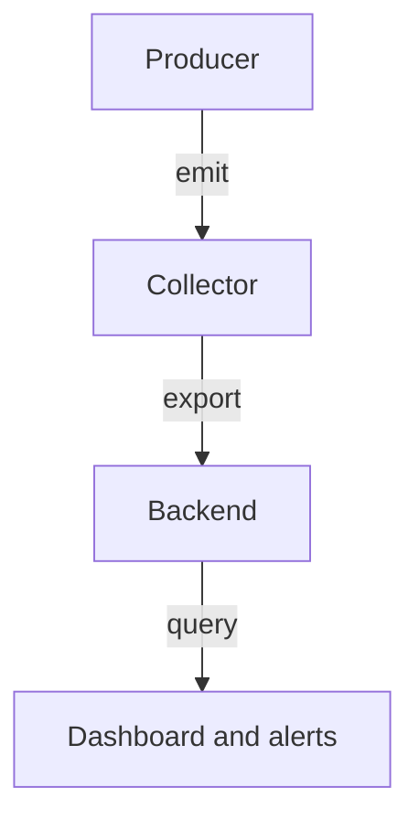

# Collection, Retention And Evidence Limits

The audit log answers one kind of question: which caller made which request to the Kubernetes application programming interface (API). A security investigation asks more. It asks what ran inside a container, what the application decided, and whether the evidence itself can be trusted. This part looks at how telemetry moves from producer to reader, where it can be lost or exposed, and what each source can and cannot establish.

## Stages of an observation pipeline

Telemetry is data that a system emits about its own behavior: logs, metrics and traces. A pipeline has four stages. A producer emits the data. A collector receives, transforms, filters and forwards it. A backend stores and queries it. A reader, a dashboard or an alert rule, presents selected results.



Each arrow is a place where data can be lost, altered or exposed. A product can bundle several stages, but the stages stay separate responsibilities with separate failures. A blank dashboard can mean no events happened, or it can mean that the producer stopped emitting, the collector could not export, the backend dropped the data, or the query used the wrong label or time range.

You can see the API audit pipeline in the playground. The producer is the API server, the destination is a file on the node, and the reader is `jq`. Check the size of the file and the age of its newest event:

<!-- astrona:playground:renew -->

```sh
export CONTROL_PLANE=astro-ats-045-playground-030-01-control-plane
podman exec "$CONTROL_PLANE" sh -c 'ls -l /var/log/kubernetes/audit/ 2>/dev/null || echo "No audit directory yet"'
```

If you have not enabled audit logging, you see the message above. That is also an observation: the pipeline has no producer. A check that only reads the file cannot tell a quiet cluster from a cluster with logging switched off. The second case needs its own signal, such as the audit flags on the API server pod.

## Instrumentation and collection

Instrumentation is the code or configuration that makes a component emit data. Automatic instrumentation covers supported libraries without code changes. Explicit instrumentation describes operations that a generic tool cannot infer, such as a business decision. A collector installed next to an application does not add instrumentation. It moves what the application already emits.

OpenTelemetry defines APIs, SDKs and a collector for producing and moving telemetry. It does not store or visualize data by itself. Prometheus stores and queries metrics, and it collects them by pulling: it requests a metrics endpoint from each target on a schedule. A reachable application port is not proof that the metrics endpoint exists, that the collector may call it, or that the labels match the query.

## Cardinality

A metric is a numeric series identified by a name and a set of label values. Each distinct label combination is a separate series that the backend must store and index. **Cardinality** is the number of distinct series.

Five routes and four response classes give twenty series, which is manageable. Adding a customer identifier for a million customers multiplies that by a million. A request identifier that is different for every request makes the metric behave like an index of single events, which a metrics backend is not designed to hold. Event-level detail belongs in logs or traces, where storage is designed for it. Labels in metrics should come from small, controlled sets that support aggregation.

The trade-off is between detail, cost and privacy. A label that holds a user name also copies personal data into the metrics system, with its own retention and access rules.

## What each source can establish

A security investigation needs the source that observes the relevant boundary. No single source covers all of them.

| Source | What it can establish | What it cannot establish |
| --- | --- | --- |
| API audit log | Which credential made which API request, when, and with what result | What happened inside a container after the request |
| Runtime detection on the node | Process, file and network activity that the sensor supports | The business identity of the person |
| Application log | The decision the application made for a request | Node-level actions it did not observe |
| Metrics | Aggregate rates and sizes over time | Individual events |

An audit event can show that a service account created a Pod. It does not prove that the Pod later ran a command. A runtime sensor can show the command but may know the container, not the user. Link observations through time, object names and identifiers. Shared credentials weaken the link between a record and a person, because several actors act under one identity.

## Collection and retention as trust boundaries

The collector and the backend have their own credentials, network paths and administrators. An attacker who can stop the collector, change its filters or delete retained records weakens the investigation. Protect those operations, and watch the evidence pipeline itself: alert on a collector that stops, on audit flags that change, and on a log file that shrinks.

Telemetry often contains sensitive values: tokens in request headers, passwords in bodies, personal data in labels. Restrict the fields that are recorded and who may read them. Maximum detail everywhere creates a store of secrets that is itself worth stealing. Retention has the same two sides. Records that expired cannot be recreated by restarting a collector after an incident. Records kept longer than needed extend the exposure of any sensitive field they contain. State the retention period for each source and make it match the time an investigation usually needs.

Timestamps need to line up. Sources with different clocks give a timeline that is wrong by the clock difference. Use a shared time source, record time zones explicitly and use stable identifiers, for example the audit ID, between sources.

## Check that the pipeline is alive

A pipeline check compares a known action with its record. Make a request that your policy records, and look for it in the log. This proves that the producer, the file and the reader all work at that moment:

```sh
kubectl -n starfleet get configmap kube-root-ca.crt -o name
podman exec "$CONTROL_PLANE" sh -c 'tail -n 1 /var/log/kubernetes/audit/audit.log' | jq '{time: .stageTimestamp, user: .user.username, verb, uri: .requestURI}'
```

The time in the newest event should be close to the current time. If it is older than a few seconds on a busy cluster, the policy drops the request type you tried, or the producer stopped. Compare the audit flags on the running API server pod with the files you expect:

```sh
kubectl -n kube-system get pod "kube-apiserver-$CONTROL_PLANE" -o jsonpath='{.spec.containers[0].command}' | tr ',' '\n' | grep -c audit
```

The count is `0` when logging is off and `5` with the audit flags set on the API server. A scheduled version of this comparison is an alert for a switched-off producer. Measure the rate as well: the number of events per minute from the recent log lets you see a sudden drop.

```sh
podman exec "$CONTROL_PLANE" cat /var/log/kubernetes/audit/audit.log | jq -r '.stageTimestamp[0:16]' | sort | uniq -c | tail -5
```

Each output line shows a minute and its event count. A pipeline that lost its producer shows a minute with zero events, and the minutes before it show what normal looked like.

## Alerts and response

An alert is a rule that turns an observation into a notification. A useful alert describes a condition that deserves attention, has an owner and has a defined response. A new cluster role binding to `cluster-admin`, a privileged Pod in a normal namespace, or a service account used from an unexpected address can deserve investigation, depending on what is normal for the platform. A rule that fires on every routine operation produces noise, and noise hides real misuse.

Detection is not prevention. A rule that reports a risk does not stop the workload from running. Some tools can also block, but their mode and failure behavior decide whether they do. Do not assume blocking from the existence of a detection rule. Read the configuration and test it with a request that the rule should stop.

## An incident, read from the evidence

Suppose audit events show that a service account `deck-cleaner` deleted a Deployment, and a runtime sensor shows that a pod in the same namespace read a mounted volume. The audit evidence explains the authority behind the API change. The mount configuration and the backend permissions explain the data access. The response restores the trusted state, removes the exposure and assesses the affected data. A deletion event alone does not prove that data stayed confidential, and a quiet dashboard does not prove that nothing happened. State what each source was able to see during the incident window, and which gaps remain.

## Common pitfalls

> [!WARNING]
> A collector does not store data and does not add instrumentation. A metric label with an unbounded value, such as a request identifier, can overwhelm the metrics backend. Missing records can mean a failed pipeline. Detection does not imply prevention, and no single source covers every trust boundary.
