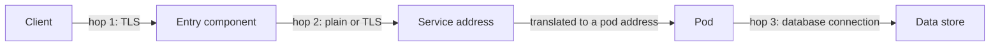

# Ingress Paths And Where Encryption Stops

A request from a client to an application passes several components, and each one makes its own decision. This part follows the request hop by hop, shows what a Service does to an address and a port, and shows why a secure browser address says nothing about the connections behind it.

## The hops of a request

A client outside the cluster connects to an address that belongs to a load balancer, a node port or a gateway. That component accepts the connection, picks a destination and opens a second connection. The pod that finally receives the request never sees the client socket. It sees the connection of the last component on the path.



Each arrow is a separate connection with its own encryption setting, its own source address and its own set of allowed callers. A policy or a certificate on one arrow does not apply to another.

## What a Service does to an address

A Service has a virtual address and a port. No pod listens on that address. On every node, `kube-proxy` (or the replacement that the network plug-in provides) installs rules that rewrite the destination of a packet. The rewrite replaces the Service address and Service port with the address of one ready pod and the port in `targetPort`.

In this module `scout` has a Service on port 80 whose `targetPort` is the container port named `http`, which is 9898. A client that connects to `scout.starfleet:80` sends a packet to the Service address and port 80. The rewrite changes it to the pod address and port 9898 before the packet leaves the node of the client or arrives at the node of the pod. Two facts follow:

- The pod sees a request on port 9898. Anything that decides on the destination port after the rewrite, such as a network policy, works with 9898 and not with 80.
- A pod that is not ready is removed from the endpoints of the Service, so the rewrite never selects it. That is a routing rule. It is not an access control.

A name such as `scout.starfleet` is resolved by CoreDNS, which runs as pods in `kube-system`. A lookup is a separate connection from the client pod to CoreDNS on port 53, over UDP first and over TCP when the answer is large. If that connection is blocked, the application fails before it sends any request.

<!-- astrona:playground:renew -->

Define a helper that prints the HTTP status of a request from a pod and `000` when no answer arrives:

```sh
reach() {
  kubectl -n "$1" exec "deploy/$2" -- curl -s -o /dev/null -w '%{http_code}\n' --max-time 4 "$3" || true
}
reach starfleet shuttle http://scout.starfleet/
reach outpost drifter http://scout.starfleet/
```

Both requests print `200`. Nothing limits the paths yet. Read the Service, its endpoints and the container port:

```sh
kubectl -n starfleet get service scout -o wide
kubectl -n starfleet get endpointslice -l kubernetes.io/service-name=scout
kubectl -n starfleet get pod -l app=scout -o wide
```

The Service lists ports 80 and 9797. The endpoint slice lists the pod address with the target ports 9898 and 9797. The pod listens on 9898, not on 80. Call the pod address directly and compare:

```sh
SCOUT_IP=$(kubectl -n starfleet get pod -l app=scout -o jsonpath='{.items[0].status.podIP}')
reach outpost drifter "http://$SCOUT_IP:9898/"
reach outpost drifter "http://$SCOUT_IP:80/"
```

The first request prints `200`. The second prints `000` after four seconds, because nothing listens on port 80 of the pod. A pod address is reachable from every namespace, which is why a policy cannot rely on a client using the Service.

## Where TLS terminates

Transport Layer Security (TLS) protects one connection between two ends. The entry component can behave in three ways:

- **TLS termination.** The entry component holds the certificate and the private key, decrypts the request and sends it on over a new connection. If the new connection is plain HTTP, the request is readable on the network between the entry component and the pod. Anyone who can capture traffic on that network, or who runs a pod that the network lets them reach, can read it.
- **TLS passthrough.** The entry component forwards the encrypted bytes without decrypting them. The pod holds the certificate. The entry component can route only on what is visible without decryption, which is the server name the client sends in the first message.
- **Re-encryption.** The entry component terminates the client connection and opens a new TLS connection to the pod. Each hop is encrypted, and the entry component still sees the plain request.

The padlock in a browser describes hop 1 only. It says nothing about hop 2 or hop 3. A design states for each hop whether it is encrypted and which side verifies the certificate of the other.

TLS on a hop also does not tell the pod who the client is, unless the pod asks the client for a certificate of its own. When a client does not present one, the server knows that the bytes were not changed and that it is the right server. It does not know the identity of the caller.

## Client information that passes through a proxy

The pod sees the address of the proxy as the source of the connection. A proxy that wants to pass the address of the original client adds it to a header, such as `X-Forwarded-For`, or to the PROXY protocol header at the start of the connection. The application reads the value from there.

A header is text that the sender writes. A client can send `X-Forwarded-For: 10.0.0.1` itself, and a proxy that appends to the header keeps the false value in front of the real one. An application can trust the value only for the part that a trusted proxy wrote. Two rules follow:

- The proxy removes or overwrites forwarding headers that arrive from the client, unless the client is itself a trusted proxy.
- The application accepts the headers only from the address of the proxy, and counts from the right when the header has several values.

Any decision on the source address, such as a rule that allows an administrator range, is only as good as this rule. A direct request to the pod, which does not pass the proxy, can carry any header.

## What a path does not give you

Reaching a pod proves that a route exists. It does not prove that the caller may use the service. An application that is open to every pod in the cluster can be called by a compromised pod in any namespace, a pod that a tenant created, or a debugging pod that someone forgot. Restricting the set of pods that can connect is the first control. It is still a control of the network, and the application needs its own check of the caller for operations that matter.

## Common pitfalls

> [!WARNING]
> A secure browser address covers only the connection between the browser and the entry component. If the entry component terminates TLS and forwards plain HTTP, the request is readable on the network behind it. Forwarding headers that a client can set are not evidence of the client address.
