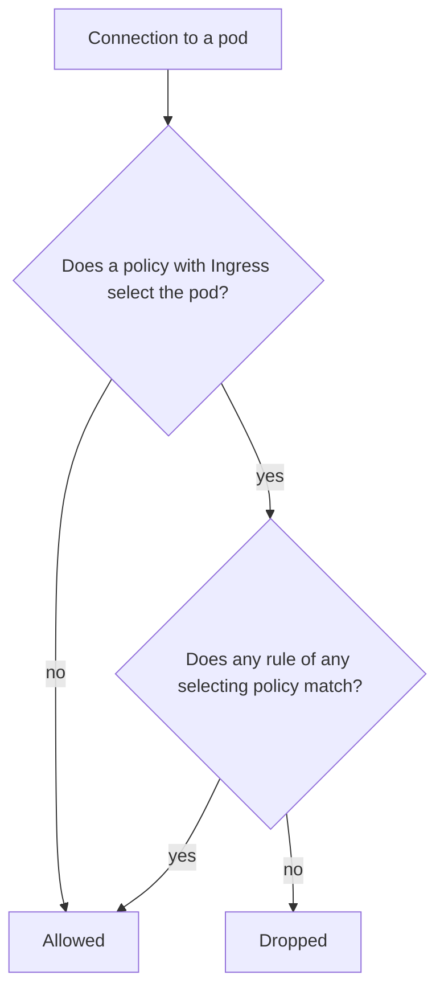

# NetworkPolicy Mechanics

A `NetworkPolicy` is a Kubernetes object that describes which connections to and from a set of pods are allowed. The API server stores it and does nothing else with it. A network plug-in on each node reads the policies and programs packet filters. This part explains how a policy selects pods, how rules add allowed paths, and how to write each kind of rule without opening more than you meant to.

## Who enforces a policy

Creating a `NetworkPolicy` on a cluster whose network plug-in does not implement policies is accepted and has no effect. The object exists, `kubectl get networkpolicy` lists it, and every connection still works. The plug-in in the playground enforces policies. Enforcement is a property of the plug-in, so a policy is only a request until a test from a pod shows the result.

The plug-in applies a change within a few seconds. A test right after `kubectl apply` can still show the old result, so repeat a check that does not yet show the change.

## What a policy selects

Every policy has a `podSelector` that selects pods in the namespace of the policy. A policy never selects pods in another namespace. An empty `podSelector: {}` selects every pod in the namespace.

A pod that no policy selects is **not isolated**. It accepts every incoming connection and may open every outgoing connection. A pod becomes **isolated for ingress** when at least one policy selects it and lists `Ingress` in `policyTypes`. It becomes **isolated for egress** in the same way with `Egress`. The two directions are independent.



If several policies select a pod, the allowed connections are the union of all their rules. A policy cannot deny a connection that another policy allows. The order of the policies does not matter, and there is no deny rule.

## Default deny

A policy that selects every pod and has no rules isolates the namespace and allows nothing:

```yaml
apiVersion: networking.k8s.io/v1
kind: NetworkPolicy
metadata:
  name: default-deny-ingress
  namespace: starfleet
spec:
  podSelector: {}
  policyTypes: ["Ingress"]
```

When `policyTypes` is left out, Kubernetes sets `Ingress`, and also sets `Egress` when the policy has an `egress` section. Write `policyTypes` explicitly so that the direction is visible. A policy with `policyTypes: ["Ingress", "Egress"]` and no rules denies both directions.

Default deny is the base of the design. Every later policy adds one allowed path to it.

<!-- astrona:playground:renew -->

Define the helper and apply the default-deny policy:

```sh
reach() {
  kubectl -n "$1" exec "deploy/$2" -- curl -s -o /dev/null -w '%{http_code}\n' --max-time 4 "$3" || true
}
kubectl apply -f - <<'YAML'
apiVersion: networking.k8s.io/v1
kind: NetworkPolicy
metadata:
  name: default-deny-ingress
  namespace: starfleet
spec:
  podSelector: {}
  policyTypes: ["Ingress"]
YAML
reach outpost drifter http://scout.starfleet/
reach starfleet shuttle http://scout.starfleet/
```

Both requests print `000` after four seconds. A dropped connection gives no answer at all, and `curl` ends on its timeout with exit code 28. A port with no listener gives an immediate refusal with exit code 7. The two results differ, and the difference tells you whether a filter or a missing listener caused the failure. Read the exit code:

```sh
kubectl -n outpost exec deploy/drifter -- curl -s -o /dev/null --max-time 4 http://scout.starfleet/; echo "exit $?"
```

## Allow rules and selectors

An `ingress` rule has a `from` list and a `ports` list. A connection matches the rule when its source matches any item of `from` and its destination port matches any item of `ports`. A rule without `ports` allows every port. A rule without `from` allows every source, so an empty `from` is as open as no policy.

An item in `from` or `to` can use three selectors:

- `podSelector` matches pods in the namespace of the policy.
- `namespaceSelector` matches all pods in the namespaces that carry the labels. Every namespace has the label `kubernetes.io/metadata.name` with its own name, which makes it possible to select one namespace.
- `ipBlock` matches an address range. Use it for addresses outside the cluster. Pod addresses can change, so a range is a weak way to name a pod.

Put one selector in an item to match pods in the policy namespace, or all pods in the selected namespaces. Put `namespaceSelector` and `podSelector` **in the same item** to match only the pods with the label in the namespaces with the label. The two selectors in one item are combined with AND. Two items are combined with OR:

```yaml
# AND: only pods labelled app=collector in the namespace ops
- from:
    - namespaceSelector:
        matchLabels:
          kubernetes.io/metadata.name: ops
      podSelector:
        matchLabels:
          app: collector
# OR: every pod in ops, and every pod labelled app=collector in the policy namespace
- from:
    - namespaceSelector:
        matchLabels:
          kubernetes.io/metadata.name: ops
    - podSelector:
        matchLabels:
          app: collector
```

The difference is one dash. A reader who skims over it can open a namespace.

Allow `shuttle` to reach `scout`:

```sh
kubectl apply -f - <<'YAML'
apiVersion: networking.k8s.io/v1
kind: NetworkPolicy
metadata:
  name: scout-from-shuttle
  namespace: starfleet
spec:
  podSelector:
    matchLabels:
      app: scout
  policyTypes: ["Ingress"]
  ingress:
    - from:
        - podSelector:
            matchLabels:
              app: shuttle
      ports:
        - protocol: TCP
          port: 9898
YAML
reach starfleet shuttle http://scout.starfleet/
reach outpost drifter http://scout.starfleet/
reach starfleet shuttle http://probe.starfleet/get
```

The first request prints `200`. The second and third print `000`: `drifter` is not in the rule, and `probe` has no allow rule. The policy lists port 9898 because the plug-in sees the connection after the Service has rewritten the destination. A policy with port 80 would block the request, even though the client used port 80.

## Egress and the DNS exception

An egress policy limits what the selected pods may send. It uses `to` in place of `from`, and it needs the destination port of the connection. Once a pod is isolated for egress, it can connect only to the destinations that a rule lists. Its name lookups are connections too, so the pod needs a rule for CoreDNS, or no name resolves:

```yaml
apiVersion: networking.k8s.io/v1
kind: NetworkPolicy
metadata:
  name: shuttle-egress
  namespace: starfleet
spec:
  podSelector:
    matchLabels:
      app: shuttle
  policyTypes: ["Egress"]
  egress:
    - to:
        - namespaceSelector:
            matchLabels:
              kubernetes.io/metadata.name: kube-system
          podSelector:
            matchLabels:
              k8s-app: kube-dns
      ports:
        - protocol: UDP
          port: 53
        - protocol: TCP
          port: 53
    - to:
        - podSelector:
            matchLabels:
              app: scout
      ports:
        - protocol: TCP
          port: 9898
```

Both protocols are needed: a lookup starts on UDP and moves to TCP when the answer does not fit in one packet. The DNS rule combines a namespace and a pod label, so it matches only CoreDNS and not every pod in `kube-system`.

Save the policy as `shuttle-egress.yaml` without its first rule (the DNS rule), apply it, and send a request by name and by pod address:

```sh
kubectl apply -f shuttle-egress.yaml
SCOUT_IP=$(kubectl -n starfleet get pod -l app=scout -o jsonpath='{.items[0].status.podIP}')
kubectl -n starfleet exec deploy/shuttle -- curl -s -o /dev/null --max-time 4 http://scout.starfleet/; echo "exit $?"
kubectl -n starfleet exec deploy/shuttle -- curl -s -o /dev/null --max-time 4 "http://$SCOUT_IP:9898/"; echo "exit $?"
```

Without the DNS rule, the request by name ends with exit code 6, which means that the host name could not be resolved. The request by pod address ends with exit code 0, because the connection to `scout` is allowed. The failure is in the lookup and not in the path to `scout`. Add the DNS rule back, apply the file again and repeat the request by name. Read the exit code before you change a rule.

## Both ends of a path

A connection needs two things: the source may send it and the destination may receive it. If `shuttle` has an egress policy, the path needs an egress rule on `shuttle` and an ingress rule on `scout`, when both pods are isolated in that direction. A pod that is not isolated in a direction does not need a rule. A reply to an allowed connection is allowed automatically, because the plug-in tracks the connection.

## What a policy does not cover

- A policy matches traffic of pods that use the pod network. A pod with `hostNetwork: true` uses the address of its node, and many plug-ins do not apply policies to it.
- Traffic from a pod to the node it runs on, and traffic from the node to its own pods, such as kubelet probes, is allowed by many plug-ins whatever the policy says. Check the behavior of the plug-in before you rely on a policy for that path.
- A policy limits connections, not requests. A connection that is allowed can carry any request of the protocol.

## Common pitfalls

> [!WARNING]
> A policy that the plug-in does not enforce is accepted and does nothing, so test every policy from the affected pod. An empty `from` or `to`, or an empty `namespaceSelector` on its own, opens every source or destination. Policies are added together and one policy cannot cancel another. Ports in a policy are the container ports, not the Service ports. Under egress isolation, name resolution needs its own rule.
